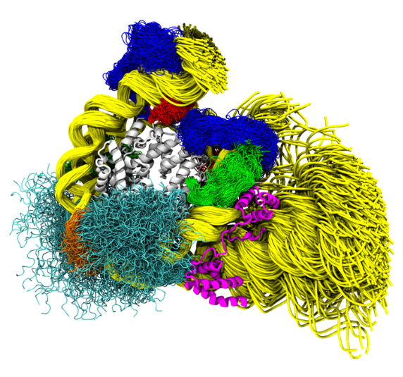

### Postdoc position
#### POSITION TAKEN

 

**We are searching for** a postdoctoral researcher for a period of approximately 2 years and 10 months (starting early 2025). The position is funded through a Romanian national grant.

**The project is aimed at** understanding the mechanisms by which a special class of proteins essential for gene regulation (transcription factors) bind to DNA when wrapped around histone proteins as it is in the genome in our cells. Transcription factors are fascinating molecules that define the identity of cells and are capable of promoting healthy or pathological cellular transitions.

**The successful candidate** will use and develop computational methods to study the interaction of transcription factors with wrapped DNA at high resolution (full or near atomistic). In addition, the successful candidate will gain skills in analyzing existing genomic data, in designing proteins, and in developing machine learning workflows to predict patterns in DNA recognition by these proteins.

**We are looking for** an enthusiastic early career research scientist holding a Ph.D. degree with a background in chemistry, physics, biology and/or computer science. Knowledge in biochemistry and experience with computers and the linux operating system are required. More advanced skills in programming and machine learning and/or prior experience with structural biology resources and software can be an advantage.

**We are also looking for** a curiosity driven, active team player fluent in English and with the potential to acquire leading skills to contribute to the supervision and mentoring of M.Sc. and Ph.D students.

**We are offering** a dynamic, inclusive and supportive environment in a research group established at the STAR-UBB Institute of the Babes-Bolyai University (highest ranked university in Romania). Our group leader has recently moved to Romania after developing a successful career in Germany and The Netherlands at prestigious research institutions. We are located in the beautiful, dynamic, history-rich university city of Cluj-Napoca surrounded by the Transylvanian hills in the vicinity of the Carpathians. The city has become a modern European city with a high quality of life.

**If you are curious** about the ways in which molecules (proteins, nucleic acids) impact our cells, organisms and life, if you are passionate about molecular biology and about using and developing computational methods to study molecules and their interactions please send a motivation letter and a Curriculum Vitae per email: vlad.cojocaru@ubbcluj.ro

**The position will be awarded** through an open competition organized by the Babes-Bolyai University. The details of this will be published in the near future.

